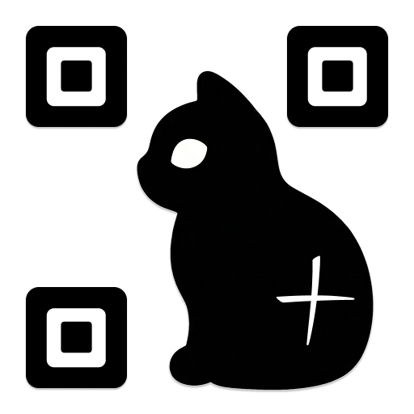
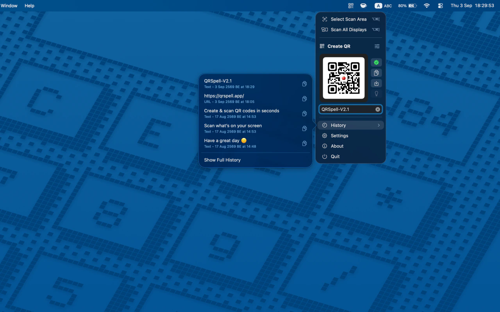
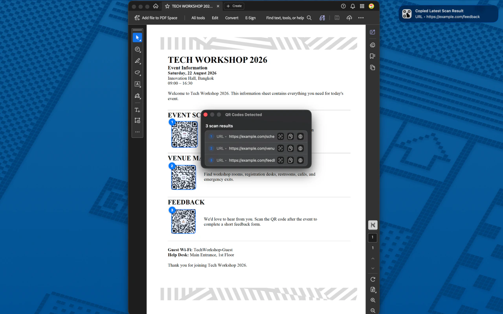
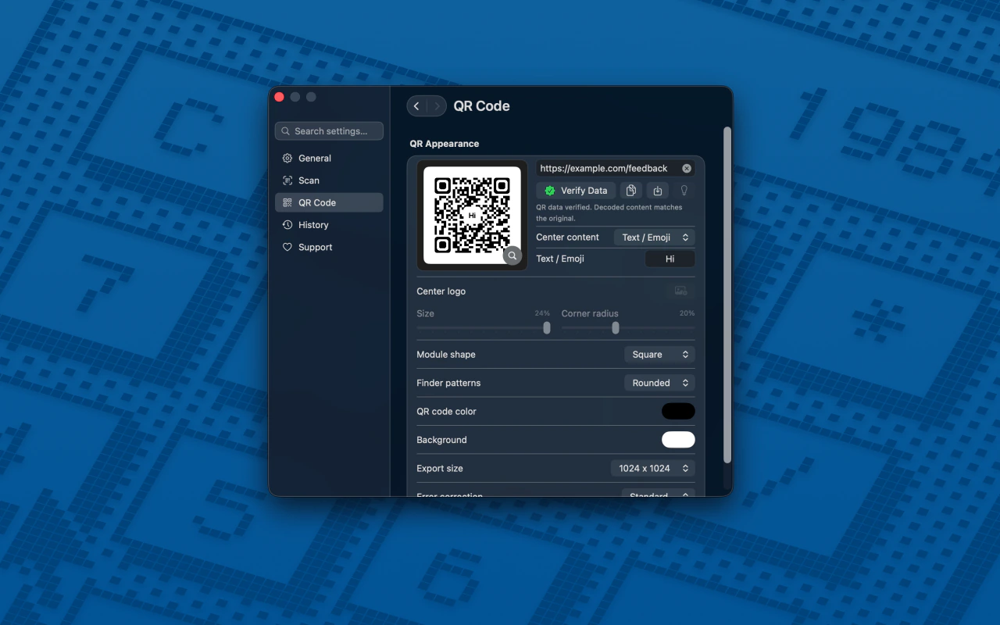
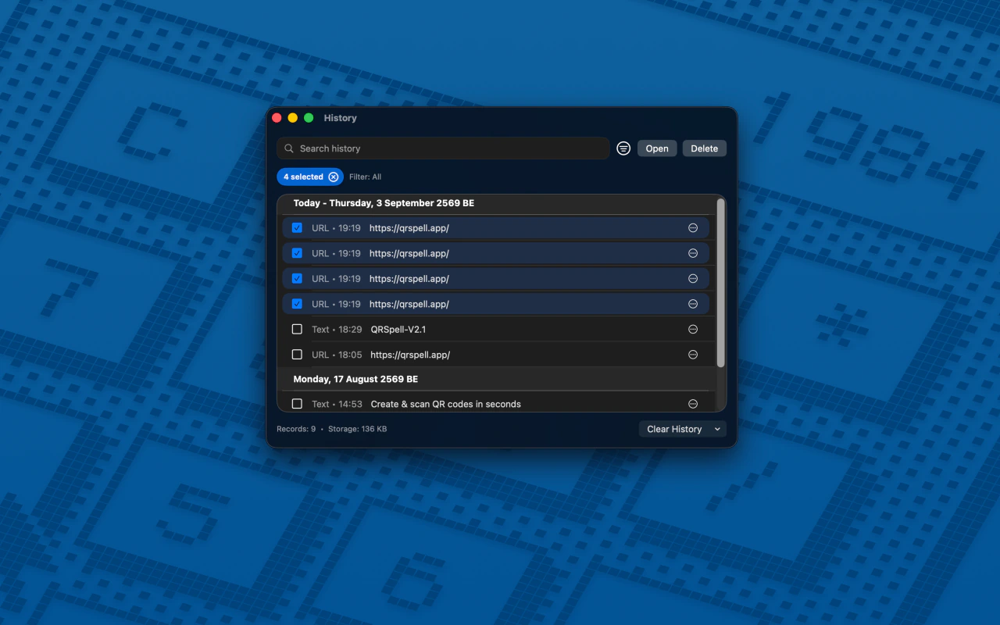

  

  <h1>QRSpell</h1>

  
<strong>QR Code Scanner &amp; Generator for Mac</strong>

  
<i>Scan QR codes on your Mac screen. Create and customize your own.</i>

  <!-- App version follows the public website and changelog, not GitHub releases. -->
  

    
    
    
    
    
    
  

  

    
  

  

    <a href="https://qrspell.app/">Website</a> &middot;
    <a href="https://qrspell.app/helpcenter/">Help Center</a> &middot;
    <a href="https://qrspell.app/changelog/">Changelog</a> &middot;
    <a href="https://qrspell.app/qr-code-generator/">Web QR Generator</a>
  

  

    <a href="#screenshots">Screenshots</a> &middot;
    <a href="#features">Features</a> &middot;
    <a href="#getting-started">Getting Started</a> &middot;
    <a href="#about-this-repository">About this Repository</a>
  

---

QRSpell is a macOS menu bar app for scanning QR codes already visible on your screen, creating custom QR codes, and keeping scan history.

Read a code from a website, PDF, or image without reaching for your phone. Scan a selected area or all visible displays, copy the results, and find them again in History.

**Scanning, QR creation, and History work offline.** Optional URL previews use an internet connection and are off by default.

## Screenshots

These screenshots are from the same QRSpell 2.1 gallery used on the [website](https://qrspell.app/).

<strong>Menu bar access, QR creation, and recent History</strong>

  

<strong>Scan multiple QR codes on screen</strong>

  

<strong>Customize QR designs and verify their data</strong>

  

<strong>Search and manage scan History</strong>

  

## Features

### Screen scanning

- **Selected area or all displays** — Read visible QR codes from websites, PDFs, and images.
- **Multiple QR codes at once** — See numbered highlights and location previews for detected codes.
- **Multiple display support** — Scan across displays with different resolutions and scaling.
- **Copy results quickly** — Copy detected values to the clipboard, with optional automatic copying.

### QR creation

- **Create from text or a URL** — Generate a QR code directly from the menu bar.
- **Customize its appearance** — Adjust colors, shapes, center content, and export size.
- **Check generated codes** — Built-in scanability checks and data verification help confirm that the code reads back correctly.
- **Copy or save** — Export your QR code for use elsewhere.

### History and everyday controls

- **Search and manage History** — Find, filter, select, and delete earlier scan results.
- **Manage local storage** — View History storage usage and remove items you no longer need.
- **Save QR preview images** — Optionally keep preview images with new scans; this is off by default.
- **Menu bar and keyboard shortcuts** — Access scanning quickly and customize separate shortcuts for selected-area and all-display scans.
- **Choose your feedback** — Configure result windows, notifications, sounds, and quiet clipboard-only use.
- **Optional URL previews** — Enable previews in Settings, then hover over the Open URL button on an HTTPS result. This feature needs internet access and is off by default.

## Requirements

- **macOS 15 or later**
- **Apple silicon Mac**
- **Screen Recording permission** for reading QR codes visible on your screen

## Getting started

1. Download QRSpell from the [Mac App Store](https://apps.apple.com/app/id6771453521) and open it.
2. Allow Screen Recording access when requested. If needed, open **System Settings → Privacy & Security → Screen & System Audio Recording** and add QRSpell from your Applications folder.
3. Make a QR code visible on your screen, then choose **Select Scan Area** or **Scan All Displays** from the QRSpell menu bar icon.
4. Copy the detected value or open a detected link. You can find earlier results in **History**.
5. To create a code, enter text or a URL in **Create QR**. Open **Settings → QR Code** to customize its appearance and export size.

For setup, permissions, and troubleshooting, visit the [Help Center](https://qrspell.app/helpcenter/).

## Free to use

QRSpell is free to download and use. **All app features are available without payment.**

Optional one-time support purchases and a yearly support subscription help fund continued development. Support purchases are processed by Apple through the App Store.

## Privacy

The **QRSpell macOS app** processes QR scanning on your Mac. Screen captures and scan History are not sent to the developer, and the app includes no ads, analytics, or tracking.

- Scan results and optional History preview images stay on your Mac.
- Scanning, QR creation, and History work offline.
- URL previews are optional and off by default. If enabled, the destination website may receive your IP address and the requested URL.
- Opening a detected link uses your browser or associated app, where the destination's privacy policy applies.

Read the [QRSpell App Privacy Policy](https://qrspell.app/privacy/) for details.

## Support and updates

- [Help Center](https://qrspell.app/helpcenter/) — FAQs, permission setup, troubleshooting, and the support email link.
- [Changelog](https://qrspell.app/changelog/) — App releases and improvements.
- [Terms of Service](https://qrspell.app/legal/) — Terms for using QRSpell.

When reporting an issue, include your QRSpell version, macOS version, Mac model, how you scanned, and what happened.

## About this repository

This repository contains the public [QRSpell website](https://qrspell.app/), built with **HTML, CSS, and JavaScript**. It includes product pages, screenshots, release notes, support information, and the [browser-based QR code generator](https://qrspell.app/qr-code-generator/).

The macOS app source code is maintained privately and is not included in this repository.

Product information in this README follows the website, Help Center, Changelog, and App Privacy Policy.
